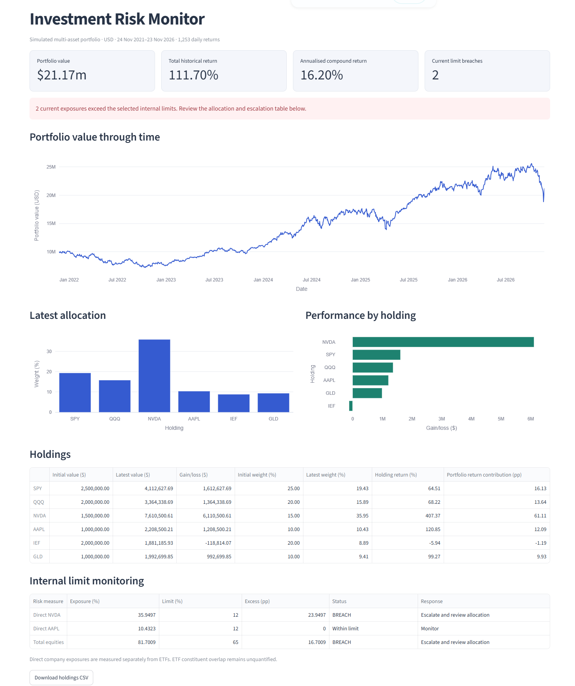

# Investment Portfolio Risk Management

A Python, Excel and Streamlit project monitoring a simulated multi-asset investment portfolio. The analysis focuses on concentration, diversification, potential losses and the trade-offs involved in a proposed rebalance.

**Working prototype.** The supplied market-data snapshot ends on **23 November 2026**. The dashboard runs locally and does not execute trades or automatically refresh prices.



## The investment risk question

A fictional portfolio begins with $10 million invested across SPY, QQQ, NVDA, AAPL, IEF and GLD. Its initial allocation is 70% equities, 20% Treasury bonds and 10% gold.

The project independently monitors how exposures develop, identifies internal risk-limit breaches, and evaluates a fully funded proposal to reduce Nvidia concentration. It is an educational investment risk case study, with fictional investment amounts and hypothetical internal limits.

## What is implemented

- Historical price download, validation and reproducible local datasets.
- Buy-and-hold portfolio values, drifting weights and holding-level performance contributions.
- Annualised volatility, maximum drawdown, historical one-day VaR and Expected Shortfall.
- Asset-return correlations and Euler volatility contributions by holding.
- Three editable stress scenarios, with current/proposed portfolio and holding-level impacts.
- Direct single-stock and total-equity limit monitoring.
- Editable proposed allocations, indicative trade funding and before/after risk comparisons.
- An interactive Streamlit dashboard with report and CSV downloads.
- An Excel workbook containing independently checked calculations and analyst commentary.

## Findings from the supplied snapshot

The simulated $10 million portfolio grows to **$21,169,852.98**, a **111.70%** total return. Nvidia's direct weight rises from **15.00% to 35.95%** and accounts for **68.61%** of estimated portfolio volatility at the latest weights.

The case-study limits identify two current breaches: Nvidia exceeds the 12% direct-stock limit, and total equities exceed the 65% allocation limit.

The evaluated proposal reduces direct Nvidia exposure to 12% and splits the released capital equally between IEF and GLD. All other holding weights remain unchanged.

| Measure | Current weights | Proposed weights |
|---|---:|---:|
| Direct Nvidia weight | 35.95% | 12.00% |
| Total equity allocation | 81.70% | 57.75% |
| Estimated annualised volatility | 27.35% | 16.21% |
| Historical 95% one-day VaR | 2.57% | 1.59% |
| Historical 95% one-day Expected Shortfall | 3.67% | 2.22% |
| Equity sell-off return | -15.43% | -9.44% |
| Technology-crash return | -25.73% | -13.99% |
| Inflation-shock return | -19.62% | -14.00% |

The current/proposed statistics apply each fixed allocation to the same historical daily asset returns. The separate **realised buy-and-hold** annualised volatility is **22.53%**, with a maximum historical drawdown of **-28.92%**.

The proposal increases bond and gold weights to **20.86%** and **21.39%**. Its lower measured equity concentration needs to be assessed alongside these new exposures. Among the proposed stress results, the technology and inflation scenarios are almost tied at approximately a 14% loss.

## Run the dashboard

Use Python 3.14 with the pinned packages. From the repository root, create and activate a virtual environment, then install:

```bash
python -m pip install -r requirements.txt
```

Launch the app:

```bash
cd Investment_Risk_Dashboard
python -m streamlit run app.py --server.headless true --server.address 127.0.0.1
```

Open the local address printed in the terminal. Keep the terminal open while using the app; press Ctrl+C to stop it. The command binds the server to the local computer and skips Streamlit's optional email prompt.

The included snapshot lets the dashboard run without downloading market data. A separate Windows guide is in [DASHBOARD_README.md](Investment_Risk_Dashboard/DASHBOARD_README.md).

## Code and deliverables

| File or folder | Purpose |
|---|---|
| download_prices.py | Download and validate approximately five years of adjusted daily prices |
| analyse_portfolio.py | Build buy-and-hold performance and holding-level reports |
| calculate_risk_contributions.py | Estimate latest-weight volatility and risk contributions |
| portfolio.csv | Original holdings and fictional starting allocations |
| Investment_Risk_Dashboard/app.py | Interactive dashboard and controls |
| Investment_Risk_Dashboard/dashboard_core.py | Portfolio, risk, stress and limit calculations |
| Investment_Risk_Dashboard/dashboard_data/ | Reviewed snapshot and explicit scenario, proposal and limit inputs |
| Investment_Risk_Dashboard/tests/ | Calculation checks and input/boundary tests |
| reports/portfolio_review.xlsx | Excel analysis and commentary |
| [reports/INVESTMENT_RISK_REPORT.md](reports/INVESTMENT_RISK_REPORT.md) | Written investment risk review |
| [reports/WORKBOOK_REVIEW.md](reports/WORKBOOK_REVIEW.md) | Workbook validation scope and results |

To reproduce the original data pipeline, run these from the repository root:

```bash
python download_prices.py
python analyse_portfolio.py
python calculate_risk_contributions.py
```

The downloader creates `data/`; the analysis scripts create `reports/`. A new download changes the analysis period and results. These pipeline scripts do not automatically update the dashboard's separate reviewed snapshot. Validate new data before replacing `Investment_Risk_Dashboard/dashboard_data/adjusted_prices.csv`, and review the proposal and assumptions after a refresh.

## Methodology and scope

Adjusted closing-price ratios approximate total returns with distributions reinvested. The historical portfolio has no rebalancing, deposits or withdrawals. Risk estimates use sample daily standard deviation/covariance and 252 trading days per year. Historical VaR uses a linearly interpolated return quantile; Expected Shortfall averages observations at or below that cutoff. Volatility contributions use Euler attribution.

Stress results use simultaneous hypothetical holding-level returns. The inflation scenario's bond shock is an assumed price change rather than a duration calculation from a specified yield movement. Costs, taxes, execution constraints and leverage are outside the model.

Direct company holdings and ETFs are monitored separately. Company exposure inside SPY and QQQ has **not** been quantified, so the project does not yet provide ETF constituent look-through. Historical risk statistics and scenario assumptions do not determine future losses or an optimal investment allocation.

## Validation

The Excel review completed **45 checks across 12 worksheets** and scanned **5,137 formulas**, with no saved formula errors. The dashboard calculation suite contains eight tests, and application checks covered all five views, confidence selection, target changes, invalid funding, reset controls and editable limits. The user-confirmed Windows overview matches the expected figures. Native Excel recalculation and visual inspection of every dashboard view were outside the review scope.

Run the calculation tests from the dashboard folder:

```bash
python -m unittest discover -s tests -v
```

## Sources and next improvements

Market-data source: Yahoo Finance through [yfinance](https://ranaroussi.github.io/yfinance/). Definitions and attribution methods draw on [CFA Institute's investment risk material](https://rpc.cfainstitute.org/sites/default/files/-/media/documents/book/rf-publication/2011/rf-v2011-n3-1-pdf.pdf). Interface: [Streamlit](https://docs.streamlit.io/) and [Plotly](https://plotly.com/python/).

Next improvements include dated ETF holdings analysis, explicit yield/duration shocks, execution-cost estimates and automated reconciliation when refreshing the data.
